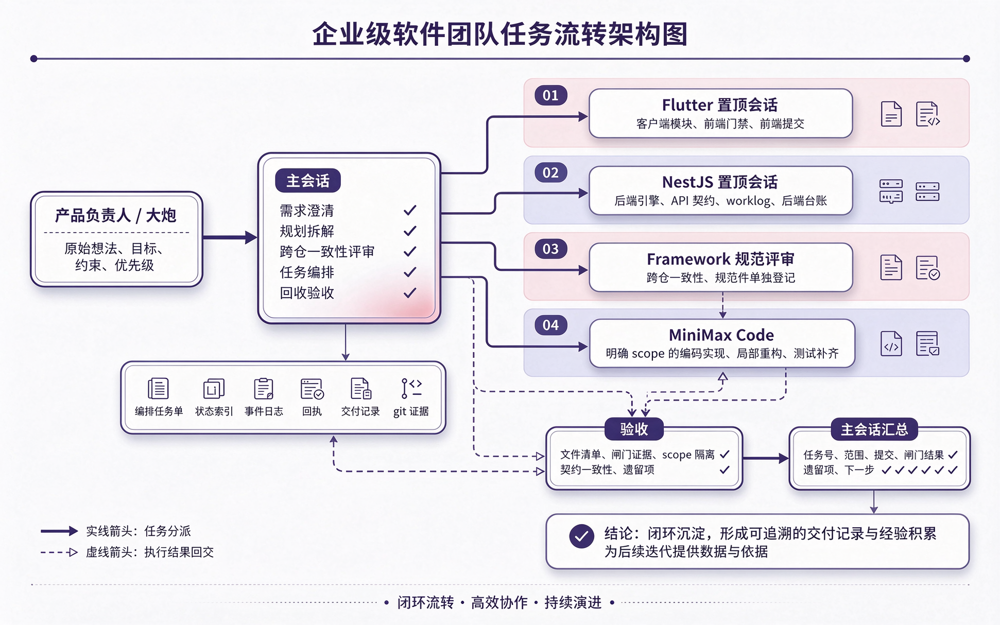

# 心塑 AI 协作任务流转规范（后端适配层引用）

> 本文件是会话分工、任务入口、执行链路与验收收口的项目协作口径。框架通用角色、状态机、回执契约与可靠性规则以 `agent-collaboration-framework` 为准；本文件只记录本项目的会话映射、分流规则、进度事实源和边界。

## 1. 目标模式

大炮只在主会话提出目标、约束、优先级和待验证问题；主会话负责澄清、拆解、依赖与优先级判断、任务定型、跨仓一致性评审、分派简报和回收验收。执行方按既定链路完成实现，结果回到主会话验收，最终沉淀进编排台账、回执、交付记录和 git 提交。

核心闭环：

```text
大炮提想法
  → 主会话澄清 / 规划 / 拆任务 / 评审跨仓一致性
  → 登记编排任务（写入型开发前置硬门）
  → 分流到 Flutter 会话、NestJS 会话、Framework 评审或 MiniMax Code
  → 执行方按 scope 实现并回交证据
  → 主会话验收：文件清单、闸门证据、scope 隔离、契约一致性、遗留项
  → 台账归档与下一步汇总
```



## 2. 角色与会话分工

| 链路 | 承担方 | 职责 | 边界 |
| --- | --- | --- | --- |
| 主会话 | 主控 AI（Doubao） | 接收原始需求；规划拆解；维护优先级与依赖；生成分派简报；组织验收；跟踪遗留项 | 不替执行方扩 scope；验收只基于工件证据与可复现闸门 |
| Flutter 置顶会话 | 客户端执行链路 | Flutter / Dart 客户端模块、前端门禁、前端任务回执与提交 | 不临时承接后端架构决策或 framework 全局口径 |
| NestJS 置顶会话 | 后端执行链路 | NestJS 后端引擎、API 契约、后端台账与 worklog | 不擅自改写前端契约口径 |
| Framework 规范评审 | 主会话 + framework 仓 | schema、状态事件、契约、校验器和适配层一致性评审 | 通用契约不承载心塑真实任务数据；规范件变更单独登记任务 |
| MiniMax Code | 编码 executor | 承接 scope 明确的编码实现、局部重构、测试补齐和回执材料 | 不做跨仓决策、不做最终验收、不越出任务文件域 |
| Human（大炮） | 审批节点 | 目标方向、路线选型、冻结动作、红线例外与验收分歧裁决 | 不参与任务路由；L4 发布、tag、对外部署等冻结动作仍需人工确认 |

## 3. 标准任务流转

### 3.1 需求进入主会话

需求可以是粗粒度方向。主会话先补齐：业务目标、验收口径、涉及仓库与模块、依赖关系、优先级、闸门要求、适合的执行链路和遗留风险。需求未定型前，不直接派发编码。

### 3.2 任务登记准入

后端任何写入型开发（代码、测试、脚本、配置、migration、seed、数据库、Redis、环境或运行态）必须先进入编排任务闭环；没有 `submitted / working` 在办任务不得开工。只读阅读、搜索、解释、`status`、`events verify` 和 `git status` 不属于写入型任务，免登记。

任务单、基线、scope.files、依赖和闸门要求以编排 CLI 与任务模板为准；状态面只能经 CLI 写入，禁止手改 `task-state-index.json`、`journal.jsonl` 或运行态投影。

### 3.3 分流规则

| 任务类型 | 优先链路 |
| --- | --- |
| Flutter 客户端页面、组件、BLoC、资源与前端门禁 | Flutter 置顶会话 / 前端编排任务 |
| NestJS API、业务引擎、AI 引擎、后端台账和 worklog | NestJS 置顶会话 / 后端编排任务 |
| schema、状态事件、契约、校验器、适配层规则与跨仓规范一致性 | Framework 规范评审，单独登记任务 |
| 文件域明确、边界清楚的编码实现、重构和测试补齐 | MiniMax Code 承接 |
| 规划、阻塞排查、跨仓对账、验收与遗留项收口 | 主会话 |

### 3.4 回交与验收

执行方回交时应给出：任务号、改动文件清单、基线 / 提交、闸门证据、回执或交付记录、偏差与遗留项。主会话验收核对：

1. 文件全部落在任务授权 scope 内；
2. 任务单、回执、交付记录和证据日志齐全；
3. 测试、lint、typecheck / analyze 等闸门结果可复现；
4. 没有混入无关重构、相邻技术债清理或越域文件；
5. 前后端契约与 framework 口径一致；
6. 未闭环遗留项已编号记录，不口头收尾。

## 4. 进度事实源

聊天会话只保留决策背景和过程记录；长期进度以仓库客观证据为准：

| 想核对的内容 | 事实源 |
| --- | --- |
| 后端任务状态、事件链、回执和归档 | 后端编排 CLI、`docs/worklog/records/`、`docs/worklog/completed/`、后端 git 提交 |
| 前端任务状态、回执、交付记录和证据 | 前端 `docs/team/agent-orchestration/records/`、`receipts/`、`evidence/`、前端 git 提交 |
| 跨仓 feature、handoff、acceptance 矩阵和合同哈希 | `xinsu-coordination` 看板、HO 编号、feature acceptance 工件 |
| MiniMax 实现结果 | MiniMax 执行记录 + 仓库回执、diff、闸门日志和提交 |
| 主会话结论 | 当前主会话；结论必须可回溯到上述工件 |

跨仓提交不写入后端回执的本仓 `changedFiles.commits`；他仓提交与其他工件引用走对应工件引用字段。

## 5. 会话与进度查看边界

- 主会话安排任务不会自动新建一个隐藏豆包会话；当前会话直接执行的任务留在当前会话查看。
- 置顶会话只有收到任务同步、或按编排台账接单后，才承接对应端跟进。
- MiniMax Code 是独立执行链路，不是豆包会话；进度看 MiniMax 记录与仓库证据。
- 需要跨仓状态对账、判断任务归属、核对闭环证据时，由主会话汇总；日常结论可从主会话获取，细节再回到对应会话、台账或 MiniMax 界面查看。

## 6. 后端特定锚点

- 后端适配层总览：`docs/team/agent-orchestration/README.md`
- 自主闭环设计备忘：`docs/team/agent-orchestration/autonomous-team-design.md`
- 后端规范与命令红线：`docs/team/conventions.md`
- 任务单模板：`docs/team/wp-task-template.md`
- 跨仓协调入口：`D:\work\Project\xinsu-coordination`

本文件若与框架仓契约、后端 README 或仓库规范冲突，按框架契约 > 适配层 README > 本协作备忘的顺序裁决。
